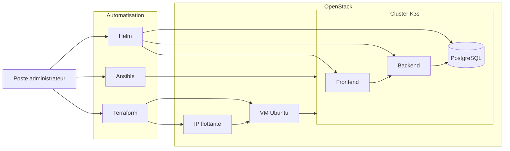

# Infrastructure as Code — K3s sur OpenStack

Ce projet automatise le déploiement d’une infrastructure Kubernetes légère sur OpenStack.

L’infrastructure est provisionnée avec **Terraform**, configurée avec **Ansible**, puis les applications sont déployées sur **K3s** à l’aide de **Helm**.

## Objectifs

- Provisionner automatiquement une machine virtuelle Ubuntu sur OpenStack
- Configurer le réseau, le groupe de sécurité et l’adresse IP flottante
- Installer et configurer un cluster K3s
- Récupérer la configuration Kubernetes
- Déployer un frontend, un backend et une base PostgreSQL
- Appliquer une démarche Infrastructure as Code reproductible

## Architecture



## Technologies utilisées

- **OpenStack** : hébergement de l’infrastructure cloud
- **Terraform** : provisionnement de la VM, du réseau et de l’IP flottante
- **cloud-init** : initialisation de la machine virtuelle
- **Ansible** : configuration du système et installation de K3s
- **K3s** : distribution Kubernetes légère
- **Helm** : déploiement des composants applicatifs
- **PostgreSQL** : base de données de l’application
- **Bash et SSH** : administration et accès distant

## Organisation du dépôt

```text
.
├── terraform/
│   ├── cloud-init.yaml
│   ├── compute.tf
│   ├── data.tf
│   ├── outputs.tf
│   ├── security.tf
│   ├── variables.tf
│   └── versions.tf
│
├── ansible/
│   ├── roles/
│   │   ├── k3s-prereq/
│   │   ├── k3s/
│   │   └── kubeconfig/
│   ├── ansible.cfg
│   ├── playbook.yml
│   └── tunnel.sh
│
└── helm/
    ├── frontend/
    ├── backend/
    └── postgres/
```

## Prérequis

Les outils suivants doivent être installés :

- Terraform
- Ansible
- Helm
- kubectl
- Git
- SSH
- Un accès à un projet OpenStack

Le projet attend également :

- un réseau OpenStack nommé `asl_net` ;
- une paire de clés OpenStack nommée `asl_key` ;
- la clé SSH privée correspondante dans `~/.ssh/asl-key`.

Les paramètres peuvent être adaptés dans les fichiers Terraform selon votre environnement.

## Déploiement

### 1. Cloner le dépôt

```bash
git clone https://github.com/Ilovetechnologyman/td2-iac-devsecops.git
cd td2-iac-devsecops
```

### 2. Charger les identifiants OpenStack

Téléchargez le fichier OpenRC depuis OpenStack, puis chargez les variables d’environnement :

```bash
source openrc.sh
```

Les identifiants et secrets OpenStack ne doivent jamais être ajoutés au dépôt.

### 3. Provisionner l’infrastructure

```bash
cd terraform

terraform init
terraform validate
terraform plan
terraform apply
```

Terraform crée notamment :

- une machine virtuelle Ubuntu ;
- un groupe de sécurité ;
- une connexion au réseau OpenStack ;
- une adresse IP flottante ;
- l’association de l’adresse IP à la VM.

Les informations utiles peuvent ensuite être consultées avec :

```bash
terraform output
```

### 4. Générer l’inventaire Ansible

Terraform génère automatiquement le contenu de l’inventaire Ansible :

```bash
terraform output -raw ansible_inventory > ../ansible/inventory.ini
```

### 5. Installer K3s avec Ansible

```bash
cd ../ansible
ansible-playbook playbook.yml
```

Le playbook exécute trois rôles :

1. préparation des prérequis du système ;
2. installation et configuration de K3s ;
3. récupération du fichier kubeconfig.

### 6. Vérifier le cluster

Après avoir configuré `KUBECONFIG` avec le fichier récupéré par Ansible :

```bash
kubectl get nodes
kubectl get pods --all-namespaces
```

### 7. Déployer les applications avec Helm

Depuis la racine du dépôt :

```bash
helm upgrade --install postgres ./helm/postgres
helm upgrade --install backend ./helm/backend
helm upgrade --install frontend ./helm/frontend
```

Les paramètres de chaque composant peuvent être personnalisés dans leur fichier `values.yaml`.

Vérification :

```bash
helm list
kubectl get pods
kubectl get services
```

## Accès distant au cluster

Le script `ansible/tunnel.sh` permet d’établir un tunnel SSH entre le poste local et l’API Kubernetes distante sur le port `6443`.

```bash
cd ansible
chmod +x tunnel.sh
./tunnel.sh
```

Ce script nécessite `sshpass`.

## Suppression de l’infrastructure

Pour détruire les ressources OpenStack créées par Terraform :

```bash
cd terraform
terraform destroy
```

Vérifiez toujours la liste des ressources avant de confirmer leur suppression.

## Sécurité

- Ne jamais versionner les identifiants OpenStack
- Ne jamais ajouter de clé SSH privée au dépôt
- Ne pas publier de kubeconfig contenant des informations sensibles
- Limiter les ports ouverts dans les groupes de sécurité
- Utiliser des secrets Kubernetes pour les données sensibles
- Personnaliser les mots de passe et valeurs par défaut avant toute utilisation en production

## Compétences mises en œuvre

- Infrastructure as Code
- Administration de systèmes Linux
- Automatisation avec Ansible
- Provisionnement cloud avec Terraform
- Orchestration de conteneurs avec Kubernetes/K3s
- Packaging et déploiement avec Helm
- Configuration réseau OpenStack
- Déploiement d’une architecture applicative distribuée
- Sécurisation des accès et gestion des secrets

## Auteur

Projet réalisé dans le cadre d’un travail pratique consacré à l’Infrastructure as Code et au DevSecOps.
